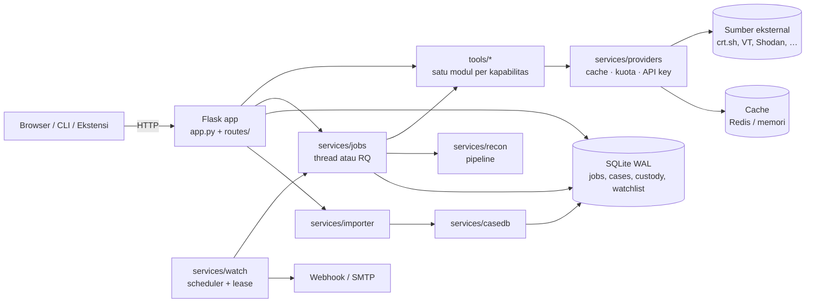
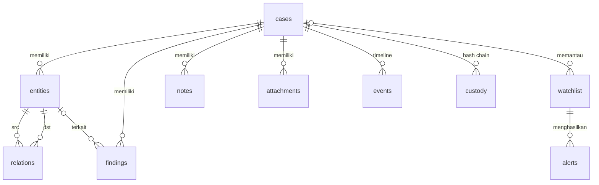

# Arsitektur

## Lapisan

| Lapisan | Lokasi | Tanggung jawab |
|---|---|---|
| Web | `app.py`, `routes/` (Blueprint cases, watch, settings, api) | Routing, auth, CSRF, rate limit, template |
| Tool | `tools/*.py` | Satu kapabilitas OSINT, mengembalikan dict JSON-serializable |
| Provider | `services/providers/` | Deklarasi sumber eksternal: TTL cache, kuota harian, API key, statistik |
| Job | `services/jobs.py`, `services/job_handlers.py` | Eksekusi background; state/progres/log/hasil di tabel `jobs`; progres via SSE |
| Recon | `services/recon.py` | Orkestrasi tahap; setiap tahap terisolasi (gagal ≠ berhenti) |
| Case | `services/casedb.py`, `services/importer.py`, `services/report.py` | Model case, ekstraksi entity, laporan |
| Watch | `services/watch.py` | Snapshot berkala, diff → alert, pengiriman, scheduler ber-lease |
| Infra | `db.py`, `services/cache.py`, `services/resolver.py`, `services/http.py`, `services/observability.py`, `services/i18n.py` | Persistensi, cache, DNS + DoH fallback, retry, metrik/log, bahasa |
| UI | `templates/`, `static/`, `services/catalog.py` | Katalog tool tunggal → menu, beranda, command palette |

## Model data case

- `entities` unik per `(case_id, type, value)`; sumber digabung saat diimpor ulang.
- `findings` unik per `(case_id, fingerprint)` → impor ulang idempoten.
- `custody.hash = SHA256(prev_hash + JSON kanonis record)`; verifikasi berjalan
  ulang dari awal rantai.

## Alur job

1. Route memanggil `jobs.enqueue(kind, target, params)` → baris `jobs` status `queued`.
2. Backend `thread` (pool proses) atau `rq` (worker terpisah) memanggil `run_job`.
3. Handler melapor via `ctx.progress()/log()/partial()` → disimpan ke DB.
4. Halaman membuka `EventSource('/api/jobs/<id>/events')` dan reload saat selesai.

## Keputusan desain

- **SQLite** dulu: nol dependensi, cukup untuk satu tim; semua akses lewat
  `db.connection()` agar mudah dipindah ke Postgres.
- **Provider abstraction** memusatkan cache/kuota sehingga modul baru otomatis
  hemat kuota dan terlihat di dashboard.
- **Sumber tanpa key tetap jalan**; yang butuh key dilaporkan "butuh key", tidak
  disembunyikan.
- **Etika**: tidak ada enumerasi akun messenger otomatis, unduhan isi bucket,
  atau eksploitasi; nilai rahasia selalu disamarkan.
